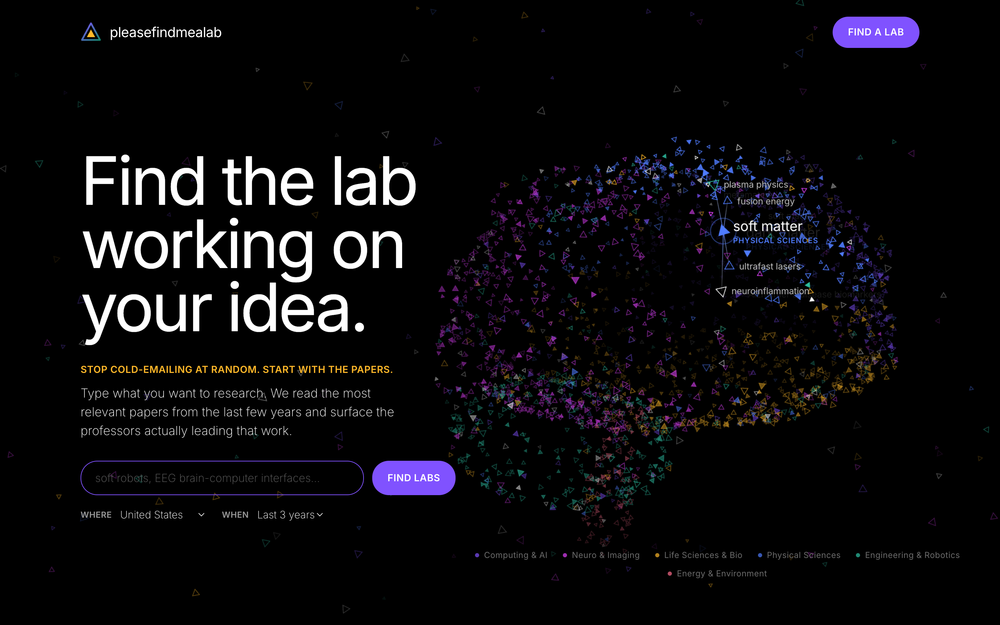
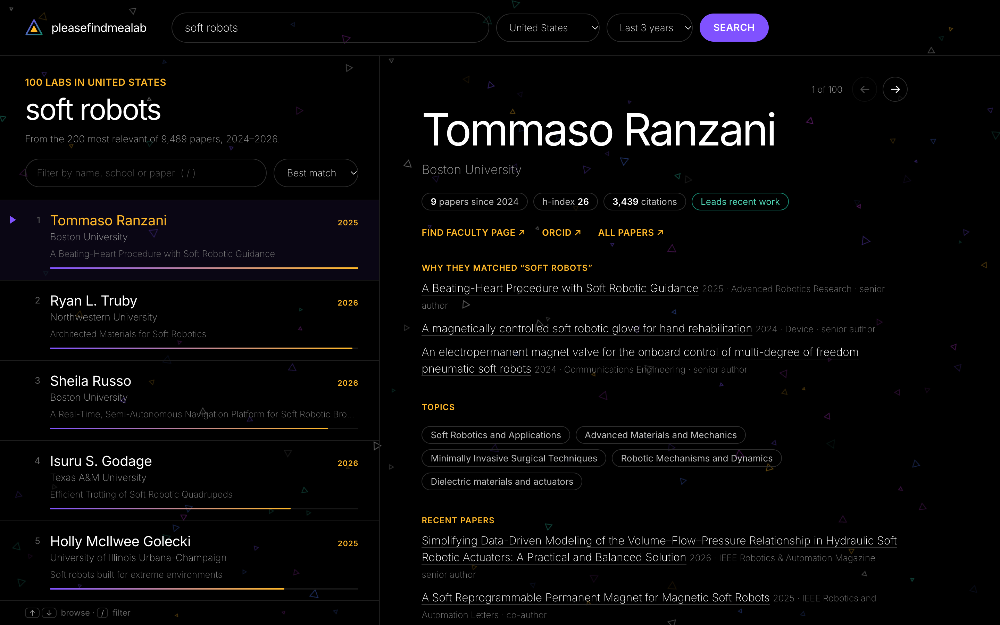
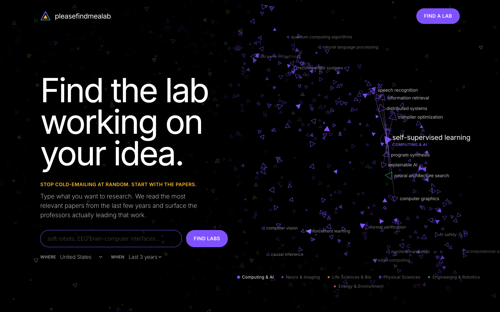
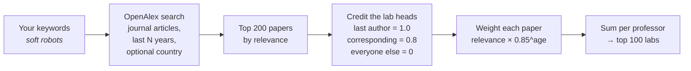

<div align="center">

# △ pleasefindmealab

**Find the lab working on your idea.**

Type what you want to research. pleasefindmealab reads the most relevant papers from the last few years<br>and surfaces the professors actually *leading* that work. Free, open data, no account.


-ffb829?style=flat-square&labelColor=000)


<br>



</div>

<br>

## Why

Cold-emailing professors for a research position usually starts with guessing. Faculty pages are out of date, rankings measure fame, and the person whose name you recognise may have stopped working on your topic years ago.

The papers don't lie. If someone has been the **senior author** on recent papers about exactly the thing you care about, they run a lab doing it *now*. pleasefindmealab does that reading for you.

<br>

## Features

<table>
<tr>
<td width="50%" valign="top">

### 🧠 A brain made of research
~2,200 triangles, each one a research topic, arranged into a slowly turning 3D brain. Every region holds a field: the frontal lobe is *Computing & AI*, the occipital lobe *Neuro & Imaging*, the cerebellum *Engineering & Robotics*.

- **Hover** a triangle to see its topic and its neighbours
- **Click** a topic (or its label) to drop it into the search bar, then refine it
- **Drag** to spin, **scroll** or **double-click** to zoom, **Esc** to reset
- **Pick a field** in the legend to fly to its region
- Zoom in and topics get labelled like place names on a map

</td>
<td width="50%" valign="top">

### 🔎 A results screen built for browsing
Every search opens its own screen (with its own shareable URL).

- 100 labs, ranked by **who leads the work**, not who's famous
- **Why they matched**: each professor's papers on your topic
- Profile with h-index, citations, topics, recent papers, and frequent collaborators
- Filter by name, school or paper; sort by match, recency, name, or institution
- Browse with <kbd>↑</kbd> <kbd>↓</kbd>, filter with <kbd>/</kbd>
- One click to search for their faculty page and email

</td>
</tr>
</table>



<p align="center"><sub>The results screen: ranked labs on the left, the selected professor's profile on the right.</sub></p>



<p align="center"><sub>Pick a field in the legend and the brain flies to that region and labels its topics.</sub></p>

<br>

## How the ranking works



1. **Search.** One OpenAlex full-text query over titles and abstracts: journal articles only, from the last 2, 3, or 5 years, sorted by relevance, top 200.
2. **Credit the people who run the lab.** In science and engineering the **last author** is usually the PI, and the **corresponding author** is the lab's point of contact. They get credit. First and middle authors (mostly students and postdocs) don't.
3. **Weight.** Each paper is worth its relevance relative to the best match, times `0.85` for every year it is older than the newest year.
4. **Rank.** Credits are summed per author. The top 100 come back, each with up to three example papers.

**Country filter, done right:** OpenAlex matches a paper if *any* author is in the chosen country, which would surface a lab in China because one co-author was in the US. pleasefindmealab only credits authors who are themselves based in that country.

All of this lives in [`app/ranking.py`](app/ranking.py) as pure, tested Python, so it's easy to tune.

<br>

## Quick start

You need [uv](https://docs.astral.sh/uv/) and a free OpenAlex API key from **https://openalex.org/settings/api**.

```bash
git clone https://github.com/saiharshilk/pleasefindmealab.git
cd pleasefindmealab
cp .env.example .env          # paste your key after OPENALEX_API_KEY=
uv sync
```

```bash
uv run --env-file .env uvicorn app.main:app --reload
```

Open **http://localhost:8000**. Interactive API docs live at **http://localhost:8000/api/docs**.

```bash
uv run pytest                 # runs offline; OpenAlex is faked
```

<br>

## API

| Endpoint | What it returns |
|---|---|
| `GET /api/search?q=soft+robots&country=US&years=3` | Ranked professors for a topic. `q` 3–200 chars · `country` optional ISO code · `years` 1–10 (default 3) |
| `GET /api/professor/{openalex_author_id}` | Profile: institutions, h-index, citations, topics, recent papers with role, frequent collaborators |
| `GET /api/health` | `{"ok": true}` |

<details>
<summary><b>Example: <code>GET /api/search?q=soft+robots&country=US</code></b></summary>

```json
{
  "query": "soft robots",
  "country": "US",
  "years": 3,
  "from_year": 2024,
  "to_year": 2026,
  "matched_papers": 200,
  "total_papers": 9489,
  "professors": [
    {
      "id": "A5059155747",
      "name": "Tommaso Ranzani",
      "institution": "Boston University",
      "country": "US",
      "orcid": "0000-0001-8362-3710",
      "score": 2.42,
      "latest_year": 2025,
      "papers": [
        {
          "title": "A Beating-Heart Procedure with Soft Robotic Guidance",
          "year": 2025,
          "cited": 7,
          "doi": "https://doi.org/10.1002/adrr.202400023",
          "venue": "Advanced Robotics Research",
          "role": "senior"
        }
      ]
    },
    …
  ],
  "cached": false
}
```
<sub>A real response, trimmed to the first professor and paper.</sub>
</details>

Errors come back as `{"detail": "..."}`:

| Status | Meaning |
|---|---|
| `422` | Bad input (query too short, unknown country code, …) |
| `429` | This visitor searched too often; wait a bit |
| `503` | Today's free OpenAlex budget is used up; try tomorrow |
| `502` | OpenAlex is down or unreachable |

<br>

## Staying free

OpenAlex gives every free API key **$1 of credit per day**.

| Call | Cost | Per day on a free key |
|---|---|---|
| Search | $0.001 | ~1,000 *new* searches |
| Professor profile | ~$0.0001 | ~10,000 |

Two things stretch that budget:

- **Cache.** Every result is stored in SQLite for 24 hours, so a repeated search or profile is free.
- **Rate limit.** Each IP gets 30 *uncached* searches an hour.

Without a key, every caller on the server's IP shares just $0.10/day.

<br>

## Configuration

Set in `.env` (see [`.env.example`](.env.example)):

| Variable | Default | |
|---|---|---|
| `OPENALEX_API_KEY` | — | Your free key. Strongly recommended. |
| `OPENALEX_MAILTO` | — | Optional contact email OpenAlex can reach you at |
| `CACHE_PATH` | `cache.sqlite3` | Where cached results live |
| `CACHE_TTL_SECONDS` | `86400` | How long results are reused |
| `SEARCHES_PER_HOUR_PER_IP` | `30` | Uncached searches allowed per visitor per hour |
| `TRUST_PROXY_HEADERS` | on for Vercel | Take the visitor's IP from `X-Real-IP` / `X-Forwarded-For` |

### Deploying to Vercel

Import the repo into [Vercel](https://vercel.com/new); it detects FastAPI and deploys with no config. Then, in **Project → Settings → Environment Variables**, add `OPENALEX_API_KEY` and redeploy. Without it, every visitor shares the tiny anonymous budget.

On Vercel the app automatically keeps its cache in `/tmp` (the only writable folder) and rate-limits by the real visitor IP that Vercel passes along. The cache lives per server instance, so it resets now and then; that only costs a few repeat searches.

### Other hosts

When deploying behind a proxy (Render, Fly, …), set `TRUST_PROXY_HEADERS=true`, or start uvicorn with `--proxy-headers --forwarded-allow-ips '*'` so rate limiting sees real client IPs. Only do this when the app is reachable *only* through that proxy.

<br>

## Project layout

```
pleasefindmealab/
├── app/
│   ├── main.py         FastAPI app: /api routes, error mapping, static files
│   ├── openalex.py     async OpenAlex client (search, author, author works)
│   ├── ranking.py      papers → ranked professors, and profile building (pure)
│   ├── cache.py        SQLite key/value cache with expiry
│   ├── ratelimit.py    per-IP sliding-window limiter
│   └── config.py       settings from environment variables
├── public/             the web page (served by Vercel's CDN, or by the app)
│   ├── index.html      home (brain) and results screens
│   ├── brain.js        the 3D topic brain and drifting background, on <canvas>
│   ├── topics.js       ~160 research topics in 6 fields
│   ├── app.js          routing, search, results list, profiles
│   └── style.css       dark theme
├── tests/              offline API and ranking tests
└── docs/screenshots/
```

No build step and no frontend framework. The brain draws about 2,200 particles per frame in a few dozen batched canvas calls.

<br>

## Design

Pure black canvas, a single violet (`#8052ff`) for actions, amber (`#ffb829`) for labels, and oversized Inter headlines with tight tracking. No cards, borders, or shadows; content floats on the void.

<br>

## Credits

- Paper and author data: [**OpenAlex**](https://openalex.org) (CC0)
- Inspired by [needalab.com](https://needalab.com) and [CSRankings](https://csrankings.org)

<div align="center">
<br>
<sub>A discovery tool, not a ranking. Always read the papers before you write the email.</sub>
</div>
